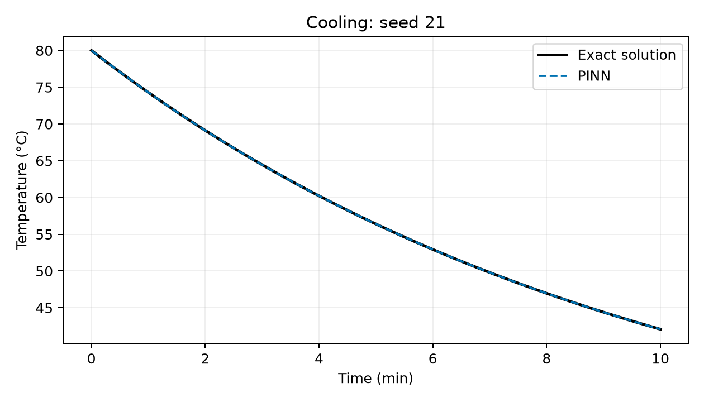

# Cooling PINN

A small PyTorch physics-informed neural network solves Newton's law of cooling using the differential equation and starting temperature.

The problem is

```text
dT/dt = -0.1 (T - 20)
T(0) = 80 °C
0 <= t <= 10 minutes
```

Training uses the equation and the initial condition. No measured temperatures or exact-solution labels enter training or checkpoint selection. The exact solution, `T(t) = 20 + 60 exp(-0.1t)`, is used only for final evaluation after checkpoint selection.

## Results

The supplied experiment used three seeds and 6,000 Adam updates per seed. Checkpoints were selected by the smallest validation residual loss plus initial-condition loss.

| Seed | Selected step | MAE (°C) | RMSE (°C) | Maximum error (°C) |
|---|---:|---:|---:|---:|
| 7 | 6000 | 0.00252663 | 0.00351887 | 0.00727131 |
| 21 | 5900 | 0.00226556 | 0.00269999 | 0.00527257 |
| 42 | 6000 | 0.00376351 | 0.00459602 | 0.00863944 |

Across seeds, mean RMSE was **0.00360496 °C**, with sample standard deviation **0.000950944 °C**. These errors were measured on a 1,001-point grid within the ten-minute interval.



See [the results report](results/RESULTS.md) and [full metrics](results/summary.json). Each seed folder contains its selected checkpoint, configuration, sample times, loss history, predictions, temperature overlay, absolute-error plot and loss plot.

## Setup and reproduction

Use Python 3.12. The recorded experiment used Python 3.12.14, PyTorch 2.11.0+cu128, NumPy 2.5.3 and Matplotlib 3.11.2. All training runs on CPU even when a CUDA-capable PyTorch build is installed. The requirements pin the library release versions; wheel variants can differ by platform.

Windows PowerShell, from the repository root:

```powershell
py -3.12 -m venv .venv
& .venv/Scripts/python.exe -m pip install -r requirements.txt
& .venv/Scripts/python.exe -m unittest -v test_cooling_pinn.py
& .venv/Scripts/python.exe cooling_pinn.py --output results-reproduction
```

macOS or Linux:

```sh
python3.12 -m venv .venv
.venv/bin/python -m pip install -r requirements.txt
.venv/bin/python -m unittest -v test_cooling_pinn.py
.venv/bin/python cooling_pinn.py --output results-reproduction
```

The default seeds are 7, 21 and 42. `--seeds` accepts a list of distinct integers; `--steps` changes the training budget. Using the default output folder, `results/`, replaces the supplied named outputs. The commands above write new results to `results-reproduction/`. Exact numerical agreement across different hardware or library builds is not guaranteed.

## Method and checks

The input is dimensionless time `tau = t/10`; the output is excess temperature `u = (T-20)/60`. The chain rule gives `dT/dt = 6 du/dtau`, so the dimensionless equation residual is `r = du/dtau + u`. Training minimizes `mean(r²) + (u(0)-1)²`; the initial condition is a soft penalty with weight 1.

The network has two hidden layers of 24 tanh units and a linear output, with 673 trainable parameters. Adam uses a fixed learning rate of 0.001, float64 arithmetic and one CPU thread. Each seed uses 128 fixed random collocation times and a separate stream of 257 validation times. Validation is checked every 50 steps. Training always completes its full budget; the saved checkpoint can come from an earlier step.

After selection, each checkpoint is reloaded from disk and checked for identical predictions on 101 probe times. Final evaluation uses 1,001 equally spaced times. The interior test points are held out; the initial endpoint is the known initial-condition constraint. Physical residuals are reported in °C/min.

The four tests check analytic residuals and physical units with a non-unit time scale, derivatives against finite differences, backpropagation through the derivative, and checkpoint serialization. The original successful test transcript is in [results/test-results.txt](results/test-results.txt).

## Provenance and limits

[results/environment.json](results/environment.json) preserves the original package versions, CPU settings and executed source hash. Machine-specific executable paths were removed before publication. Its source hash matches [provenance/executed_cooling_pinn.py](provenance/executed_cooling_pinn.py), the unchanged source that produced the supplied results. The main `cooling_pinn.py` differs only in environment logging: future logs omit executable and output paths and record portable training arguments. Training, selection and evaluation calculations are unchanged.

Checkpoints contain selected model weights and configuration, not optimizer state for resuming training. `relative_l2_temperature` normalizes the error by the exact temperature norm; `relative_l2_excess_temperature` normalizes by the exact temperature above ambient. Seed variation uses the sample standard deviation (n−1).

This is one forward problem with known constants. Changed conditions, inverse estimation, noisy observations and extrapolation have not been tested. A small residual alone does not establish solution accuracy; this example also checks against the exact solution. Finite grids do not provide a rigorous error bound between points, and three seeds do not establish general PINN reliability.

PyTorch reference: [automatic differentiation API](https://docs.pytorch.org/docs/stable/generated/torch.autograd.grad.html).
